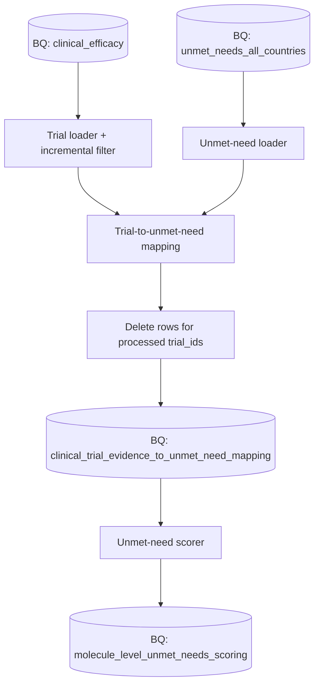
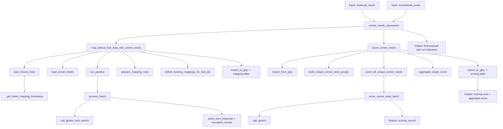

# Molecule-Level Unmet Needs Assessment (Biweekly)

## Purpose

Determine how well each molecule addresses known unmet needs and compute a weighted molecule-level score.

Primary orchestrators:
- Core orchestrator (no CLI): `unmet_needs_assessment.py`
  - Function: `unmet_needs_assesment(molecule_name, incremental_mode=True)`
- Call the core orchestrator from application code or a scheduled workflow;

Core implementation modules:
- `compute_unmet_need_score_from_trial_data/trial_to_unmet_needs_mapper.py`
- `compute_unmet_need_score_from_trial_data/unmet_need_scorer.py`
- `compute_unmet_need_score_from_trial_data/bq_utils.py`

## How This Pipeline Works

1. Resolve the execution mode
- Incremental mode: process only trials newer than the last processed timestamp for the molecule.
- Full refresh mode: process all eligible trials and write mapping output using truncate behavior.

2. Load and prepare molecule trial evidence
- Read trial rows from `clinical_efficacy`.
- In incremental mode, use latest `created_at_utc` from mapping table as cutoff.
- Keep one canonical row per `trial_id` using phase-priority and deterministic tie-breaking.

3. Load unmet-needs baseline
- Read unmet-need records from `unmet_needs_all_countries`.
- Apply configured category exclusions so only in-scope needs are assessed.

4. Generate trial-to-unmet-need mappings
- Batch trials and call Gemini with trial + unmet-need context.
- Parse and normalize model outputs.
- Re-attach canonical trial and unmet-need metadata before persistence.

5. Keep mapping table idempotent for processed trials
- Identify `trial_id`s processed in current run.
- Delete existing mapping rows for those IDs, then write refreshed rows.

6. Score unmet needs for the molecule
- Read mapping rows back from BQ.
- Group into unique unmet-need units.
- Score each group with Gemini and compute weighted row-level scores.
- Aggregate to a molecule-level unmet-need score.

7. Persist scoring output and return run payload
- Write scoring rows to `molecule_level_unmet_needs_scoring`.
- Return operational indicators (`clinical_trials_assessed`, counts, scoring status).

## BigQuery Data Flow

## Function Input-to-Output Flow

## Key BigQuery Tables

Input tables:
- `cognito-prod-394707.cognito_prod_datamart.unmet_needs_all_countries`
- `cognito-prod-394707.cognito_prod_datamart.clinical_efficacy`

Output tables:
- `cognito-prod-394707.cognito_prod_datamart.clinical_trial_evidence_to_unmet_need_mapping`
- `cognito-prod-394707.cognito_prod_datamart.molecule_level_unmet_needs_scoring`

## Operating Modes

- Incremental (default): process only newly created/updated trials.
- Full refresh: process all candidate trials and truncate mapping-write target before load.

## Recommended Practices

- Keep all writes schema-driven using shared schema definitions in `compute_unmet_need_score_from_trial_data/bq_utils.py`.
- Use parameterized SQL for every runtime input.
- Keep all timestamps and cutoffs in UTC.
- Preserve idempotency with delete-before-append or full-refresh truncate mode.
- Monitor operational quality:
  - no-trials-assessed frequency,
  - parser fallback/error rates,
  - BQ row counts loaded vs expected.
- Store run metadata (molecule, mode, row counts, start/end timestamps) for audit and troubleshooting.
