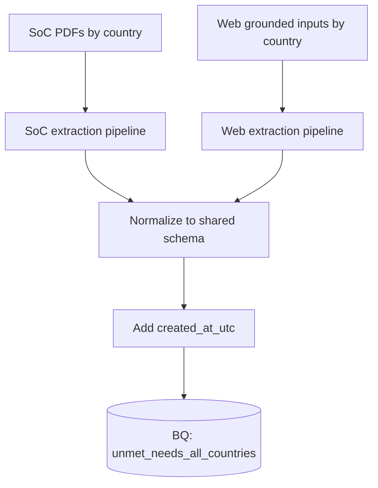
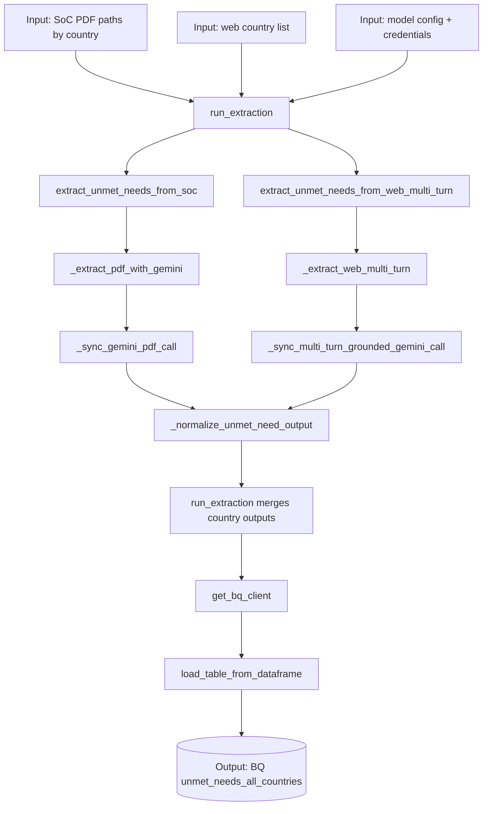

# Unmet Needs Extraction

## Purpose

Build and refresh a single, standardized unmet-needs baseline across countries.
This baseline is the source-of-truth input for molecule-level assessment.

Main entry point:
- `unmet_needs_extraction/run_unmet_needs_extraction.py`

Supporting modules:
- `unmet_needs_extraction/unmet_needs_extraction_from_soc.py` (SoC PDF extraction)
- `unmet_needs_extraction/unmet_needs_extraction_from_web.py` (web-grounded extraction)
- `unmet_needs_extraction/utils.py` (JSON normalization, token helpers)
- `unmet_needs_extraction/prompts.py` (prompt templates)

## How This Pipeline Works

1. Initialize execution context
- Load credentials, model settings, and country configuration.
- Build country-to-input mapping for SoC PDFs and web countries.

2. Extract unmet needs from SoC documents
- For each configured SoC country, read all available PDF guidance docs.
- Send content to Gemini and request unmet-need extraction in structured form.
- Normalize each response into a consistent row schema.

3. Extract unmet needs from web-grounded research
- For each configured web country, run a grounded multi-turn Gemini workflow.
- Capture generated unmet needs plus source context.
- Normalize into the same schema as SoC extraction.

4. Merge and standardize output rows
- Concatenate SoC and web results.
- Add `created_at_utc` so every row has clear load lineage.

5. Load baseline into BigQuery
- Write to `cognito-prod-394707.cognito_prod_datamart.unmet_needs_all_countries`.
- Use explicit schema and append mode.

6. Publish run-level telemetry
- Print combined token usage to support run monitoring and cost governance.

## BigQuery Data Flow

## Function Input-to-Output Flow

## Inputs and Outputs

Inputs:
- SoC PDF directories by country
- Web country list
- Gemini model + credentials

Output table:
- `cognito-prod-394707.cognito_prod_datamart.unmet_needs_all_countries`

Key output columns:
- `unmet_need`, `category`, `evidence`, `country`, `source`, `created_at_utc`

## Recommended Practices

- Validate input availability before extraction (missing directory/file checks).
- Keep prompt templates versioned and auditable.
- Use explicit BQ schema (avoid schema autodetect in production).
- Add post-load data checks:
  - row count thresholds,
  - required field non-null checks,
  - duplicate pattern detection.
- Define a refresh policy (append + dedup, or periodic replace) and document it.
